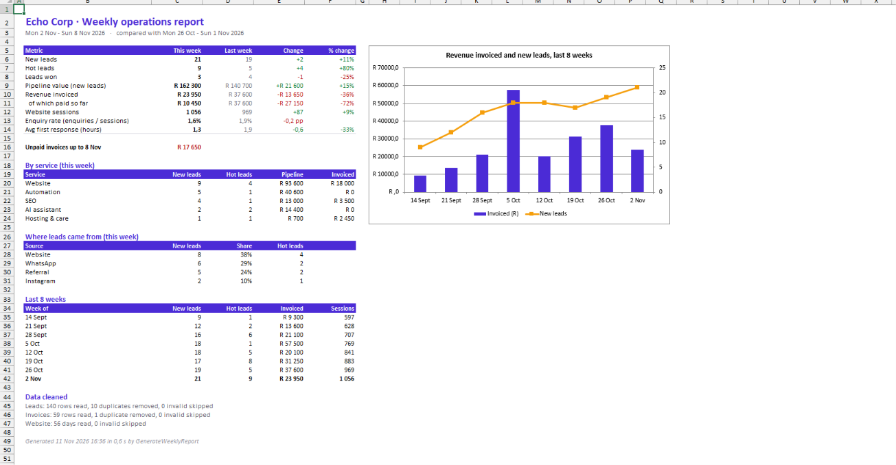
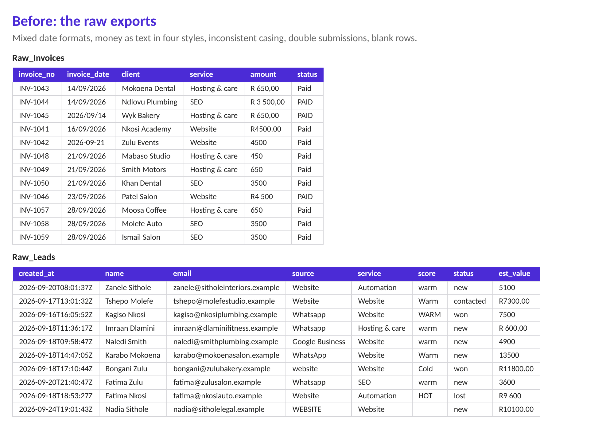

# vba-weekly-stats

**An Excel VBA macro that turns a 3-hour weekly report into one click.**

I first wrote a macro like this to automate a weekly statistics report that took about **3 hours** to build by hand: copying exports together, fixing dates and amounts, counting, comparing with last week, formatting and saving a PDF. After the macro it took **one click and a few seconds**.

The original workbook isn't mine to share, so this repo is a rebuild of the same idea for my own agency, [Echo Corp](https://echocorp.co.za). It uses **made-up sample data**.

## What one click does

1. **Checks** that each raw sheet has the expected columns. If someone pastes the wrong export, they get a clear message instead of a wrong report.
2. **Cleans** three messy exports (leads from the website form, invoices, website stats):

   | Problem in the export | Example | Cleaned to |
   |---|---|---|
   | Mixed date formats | `2026-11-03T09:14:22Z`, `03/11/2026`, `2026/11/03`, a real Excel date | one date |
   | Money stored as text | `R 4 500,00`, `R4500.00`, `R4 500`, `4500` | `4500` |
   | Inconsistent labels | `website`, `WEBSITE`, `Website ` | `Website` |
   | Inconsistent scores | `HOT `, `Hot`, ` hot`, blank | `hot`, or `unscored` if blank |
   | Duplicates | the same person submitting the form twice in one day, an invoice exported twice | removed and counted |
   | Blank or invalid rows | an empty row, a row with no email | skipped and counted |

3. **Calculates** this week against last week (Monday to Sunday): new leads, hot leads, leads won, pipeline value, revenue invoiced and paid, website sessions, enquiry rate and average first-response time.
4. **Builds the Report sheet:** a KPI table with change and % change coloured green or red (response time counts as better when it goes *down*), breakdowns by service and lead source, unpaid invoices, an 8-week trend table and a combo chart.
5. **Saves a PDF** next to the workbook, named `Echo weekly report 2026-11-02.pdf`.
6. **Shows what it cleaned,** for example "140 rows read, 10 duplicates removed", so you can trust the numbers.

### Before

## Try it

1. Download [`data/Echo_Weekly_Report.xlsm`](data/Echo_Weekly_Report.xlsm) and open it in Excel for Windows.
2. Click **Enable Content** when Excel asks about macros.
3. On the **Control** sheet, click **Generate weekly report**.

To report on a different week, type any date in that week into `Control!C4`. Leave it blank to use the latest full week in the data.

### Build it yourself from source

The VBA lives in plain `.bas` files so it can be read and versioned on GitHub:

1. Open [`data/Echo_Weekly_Report.xlsx`](data/Echo_Weekly_Report.xlsx) and press **Alt+F11**.
2. Go to **File → Import File** and import both files in [`src/`](src).
3. Press **Alt+F8**, then run `AddReportButton`.
4. Save as **Excel Macro-Enabled Workbook (.xlsm)**.

To make fresh sample data, run `python tools/make_sample_data.py` (needs `openpyxl`).

## How the code is organised

[`src/modWeeklyReport.bas`](src/modWeeklyReport.bas):

| Part | What it does |
|---|---|
| `GenerateWeeklyReport` | Entry point. Turns off screen updating, runs each step, always restores Excel's settings, even after an error |
| `LoadLeads` / `LoadInvoices` / `LoadWeb` | Read each sheet into an array in one go (much faster than reading cell by cell), clean each row and drop duplicates using a `Collection` as a lookup |
| `ParseDate`, `ParseMoney`, `NormSource`, `NormScore` | The cleaning rules. Dates are parsed explicitly as day/month/year, so `03/11/2026` means 3 November whatever the PC's regional settings are |
| `GetStats` | Returns every KPI for one week as a single `WeekStats` record. It's reused for this week, last week and the 8-week trend |
| `BuildReport`, `KpiRow`, `ServiceTable`, `SourceTable`, `AddTrendChart` | Write and format the report |
| `SavePdf` | Exports the PDF. It handles workbooks that were never saved and OneDrive paths that are URLs |

[`src/modSetup.bas`](src/modSetup.bas) adds the button.

## How I tested it

- The numbers were checked against an independent Python calculation over the same sample data. Every KPI and all 8 trend weeks match.
- I also tested picking a past week through `Control!C4`, a wrong column header (which gives a clear error), and the PDF fallback when the workbook hasn't been saved.

## The next step: no clicks

The same report also exists as an automated **n8n workflow** that runs every Monday at 07:00 and emails the results. See [n8n-workflows → 04 Weekly stats report](https://github.com/RiyasatR23/n8n-workflows). VBA is the right tool when the data lives in Excel. Once the data is in a database, a scheduled workflow removes the click too.

## Built with

Excel VBA · Python (openpyxl) for the sample data generator

---

Riyasat Rehman · [LinkedIn](https://www.linkedin.com/in/riyasat-rehman-784724386) · [Echo Corp](https://echocorp.co.za)
